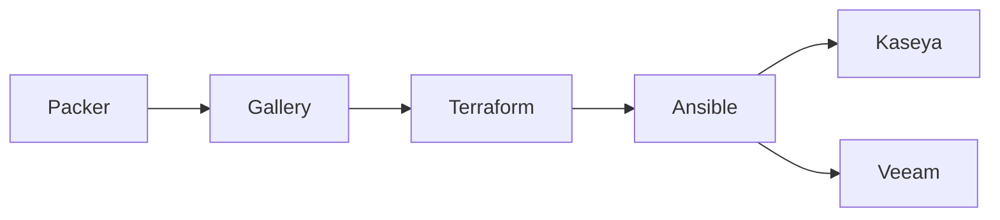

# Automatic Deployment of Veeam Backup and Recovery Server to Azure, Using Packer/Terraform/Ansible

Packer image → Azure Compute Gallery → Terraform VM → Ansible for Kaseya and Veeam.

Three tools:

- **Packer** — OS, updates, sysprep. 
- **Terraform** — Azure objects: gallery, network, NSG (RDP + WinRM from my IP), the VM, also creates a 7pm shutdown script to save VM resources in lab.
- **Ansible** — stuff inside the box, after the hostname exists. Kaseya agent + Veeam Backup silent install (answer file).



## folders

- `tf-gal/` — gallery + image definition
- `packer-win2022/` — bake 2022 Gen2, publish a version
- `tf-demo/` — throwaway VM from `latest`
- `ansible/` — `site.yml` + install scripts

## run

```
cd tf-gal         && terraform apply
cd packer-win2022 && packer init . && packer build .
cd tf-demo        && terraform apply
cd ansible        && ./run.ps1
# then in WSL:
ansible-playbook -i inventory.ini site.yml -e @extra-vars.json
```

## config (gitignored)

Copy each `*.example` and fill these in. Same Azure subscription everywhere.

```
cp tf-gal/terraform.tfvars.example                    tf-gal/terraform.tfvars
cp packer-win2022/packer.auto.pkrvars.hcl.example     packer-win2022/packer.auto.pkrvars.hcl
cp tf-demo/terraform.tfvars.example                   tf-demo/terraform.tfvars
cp ansible/inventory.ini.example                      ansible/inventory.ini
cp ansible/extra-vars.json.example                    ansible/extra-vars.json
cp ansible/group_vars/vbr.yml.example                 ansible/group_vars/vbr.yml
```

**subscription** — Azure subscription GUID, three files:

```
# tf-gal/terraform.tfvars
# packer-win2022/packer.auto.pkrvars.hcl
# tf-demo/terraform.tfvars
subscription_id = "00000000-0000-0000-0000-000000000000"
```

**ip** — your public IP (NSG allows RDP 3389 + WinRM 5985 from this only). After `tf-demo` apply, put the VM's public IP in inventory.

```
# tf-demo/terraform.tfvars
my_ip = "1.2.3.4"

# ansible/inventory.ini
[vbr]
vm-test01 ansible_host=x.x.x.x ansible_user=mspadmin
```

**urls** — read-only HTTPS SAS URLs to the Kaseya agent and Veeam ISO in blob storage.

```
# ansible/group_vars/vbr.yml
kaseya_url: "https://YOURACCOUNT.blob.core.windows.net/agents/Kaseya.exe?sp=r&..."
veeam_url: "https://YOURACCOUNT.blob.core.windows.net/agents/Veeam.iso?sp=r&..."
```

Also: `image_version` in the packer vars file (e.g. `"1.0.0"`), and `ansible_password` in `extra-vars.json` from `terraform output -raw admin_password` (`run.ps1` does this).
